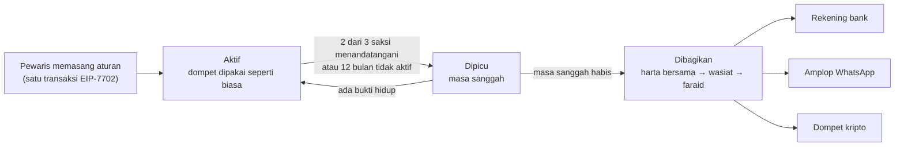

<div align="center">

<picture>
  <source media="(prefers-color-scheme: dark)" srcset="web/public/logo.svg" />
  
</picture>

# Pusaka

**Warisan kripto yang dibagi sesuai faraid, di blockchain Monad.**

Ahli waris tidak perlu dompet kripto. Pewaris tidak perlu menekan tombol apa pun.

[**Demo live**](https://pusakafaraid.xyz) ·
[Kontrak](#kontrak-yang-di-deploy) ·
[Mulai cepat](#mulai-cepat) ·
[Dokumen](#dokumen)

[English](README.md) · Bahasa Indonesia

-6E54FF)


</div>

---

## Masalahnya

Saat seseorang wafat, aset kriptonya biasanya ikut hilang karena tidak ada yang tahu seed phrase-nya. Kalaupun
keluarga bisa membukanya, membaginya dengan adil jadi urusan tersendiri. Menurut Kompilasi Hukum Islam (KHI),
harta bersama untuk pasangan dipisahkan dulu, lalu wasiat (paling banyak 1/3), baru sisanya dibagi ke ahli waris
dengan bagian yang sudah ditentukan (faraid). Menghitungnya manual lambat, rawan salah, dan sering berujung ke
pengadilan.

## Yang dilakukan Pusaka

Pewaris memasang aturan warisan **langsung di dompetnya sendiri**, sekali saja. Hartanya tidak perlu dipindah ke
kontrak lain. Saat pewaris wafat, dompet itu membayar bagian tiap ahli waris secara tepat dan otomatis.



| | Caranya |
|---|---|
| **Aturan ada di dompet pewaris** | EIP-7702 mengubah alamat biasa milik pewaris menjadi dompet pintar. Hartanya tetap di tempat. |
| **Bukti hidup gratis** | Aktivitas dompet sehari-hari sudah dihitung. Bisa juga pesan "Saya masih hidup" yang ditandatangani (dikirim relayer, Rp0 untuk pewaris) atau **sidik jari / Face ID** (passkey, diperiksa di blockchain oleh precompile P-256 Monad). |
| **Wafat dikonfirmasi manusia, bukan satu kunci** | 2 dari 3 saksi menandatangani (tanpa gas), atau dompet tidak aktif 12 bulan. Setelah itu ada masa sanggah, dan bukti hidup apa pun membatalkannya. |
| **Faraid yang eksak di blockchain** | `FaraidLib` menghitung bagian dengan pecahan eksak, termasuk ‘aul, radd, dan ‘ashabah. Diuji dengan 24 kasus rujukan. |
| **Ahli waris tidak perlu kripto** | Tiap ahli waris memilih cara terima: **rekening bank** (rekening virtual di mitra pencairan → transfer BI-FAST, disimulasikan di testnet), **amplop digital** berupa tautan WhatsApp (dicairkan ke bank atau e-wallet dari HP), atau dompet kripto. |

## Coba dalam 2 menit

Tidak perlu dompet atau instalasi. Semuanya berjalan di Monad testnet dengan rupiah mainan (tIDR).

1. Buka **[pusaka-faraid.vercel.app/pewaris](https://pusaka-faraid.vercel.app/pewaris)** (layar pewaris). Pakai
   keluarga contoh, pilih cara terima tiap ahli waris, lalu tanda tangani. Dompet demo otomatis diberi gas testnet.
2. Buka **[/saksi](https://pusaka-faraid.vercel.app/saksi)**. Tahan tombol di dua kartu saksi. Masa sanggah dimulai.
3. Kembali ke layar pewaris, tunggu masa sanggah habis (20 detik di demo; aslinya 12 bulan tidak aktif), lalu tekan
   **Bagikan warisan**.
4. Buka **[/panggung](https://pusaka-faraid.vercel.app/panggung)** (tampilan proyektor) atau
   **[/hp](https://pusaka-faraid.vercel.app/hp)** (empat HP berdampingan) untuk melihat bagian tiap ahli waris masuk.
   Setiap langkah adalah transaksi sungguhan dengan tautan ke block explorer.

Layar lain: [`/kabar`](https://pusaka-faraid.vercel.app/kabar) (HP pewaris: "Saya masih hidup", sidik jari),
[`/mitra`](https://pusaka-faraid.vercel.app/mitra) (mitra pencairan, simulasi bank),
[`/kalkulator`](https://pusaka-faraid.vercel.app/kalkulator) (kalkulator faraid).

## Kontrak yang di-deploy

Monad testnet, chain id `10143`. Source terverifikasi di Sourcify (exact match).

| Kontrak | Alamat | Fungsi |
|---|---|---|
| `PusakaWallet` | [`0xeea3b2c6040B0eACb3E451A6f13bA11db547e096`](https://testnet.monadvision.com/address/0xeea3b2c6040B0eACb3E451A6f13bA11db547e096) | Kode yang dipasang di dompet pewaris (EIP-7702): aturan, saksi, bukti hidup, pembagian |
| `MitraCair` | [`0x04405E9Fd9ed041F81086259Bf200990B9EC315F`](https://testnet.monadvision.com/address/0x04405E9Fd9ed041F81086259Bf200990B9EC315F) | Mitra pencairan: rekening virtual per ahli waris, pencairan amplop |
| `MockIDR` (tIDR) | [`0xbEe6644173F8eB599d83B9a6A92e7BE14b4242aB`](https://testnet.monadvision.com/address/0xbEe6644173F8eB599d83B9a6A92e7BE14b4242aB) | Token rupiah mainan (ERC-20 + permit) |

| | |
|---|---|
| Aplikasi live | https://pusakafaraid.xyz (cadangan: https://pusaka-faraid.vercel.app) |
| Repo | https://github.com/astrorehan/pusaka |
| Catatan deploy | [`contracts/broadcast/Deploy.s.sol/10143/run-latest.json`](contracts/broadcast/Deploy.s.sol/10143/run-latest.json) |

## Mulai cepat

**Kebutuhan:** [Foundry](https://getfoundry.sh) dan [Node.js](https://nodejs.org) 20+.

### 1. Clone dan jalankan tes kontrak

```bash
git clone --recurse-submodules https://github.com/astrorehan/pusaka
cd pusaka/contracts
forge build
forge test
```

Di Windows, jalankan `git config --global core.longpaths true` sebelum clone (submodule OpenZeppelin punya path
yang panjang).

### 2. Jalankan aplikasi lengkap di blockchain lokal

Terminal 1, nyalakan blockchain lokal dengan aturan Monad:

```bash
anvil --network monad --block-time 1 --mixed-mining --code-size-limit 131072
```

Terminal 2, dari akar repo:

```bash
npm install                       # dependensi relayer (viem)
cd web && npm install
node scripts/deploy-lokal.mjs     # deploy semua kontrak, menulis web/.env.local
npm run dev                       # http://localhost:5180
```

Anvil di port lain? Tambahkan `RPC=http://127.0.0.1:<port>` di depan perintah skrip.

Buka http://localhost:5180/pewaris dan ikuti langkah yang sama seperti demo live. Anvil dinyalakan ulang? Jalankan
`deploy-lokal.mjs` lagi lalu mulai ulang `npm run dev`.

### 3. Uji ujung ke ujung tanpa browser

Selama anvil masih jalan:

```bash
cd web && node scripts/e2e.mjs
```

Skrip ini memasang aturan, mengonfirmasi wafat lewat saksi, membagikan, mencairkan ke rekening bank, dan mencairkan
amplop, semuanya dengan transaksi sungguhan.

### Menjalankan di Monad testnet

Deploy dengan `forge script` (lihat [`contracts/README.md`](contracts/README.md#deploy)), isi alamat kontrak dan kunci
**khusus testnet** di `web/.env.monad.local` (contoh: [`web/.env.example`](web/.env.example)), cek dengan
`ENV_FILE=.env.monad.local node scripts/cek-siap.mjs`, lalu jalankan `npm run dev -- --mode monad`. Perilaku khusus
Monad (reserve balance, gas ditagih dari batasnya) dijelaskan di [`web/README.md`](web/README.md#monad-testnet).

## Cara kerja

```
Dompet pewaris (EOA) ──EIP-7702──▶ kode PusakaWallet
                                     ├─ FaraidLib   bagian faraid yang eksak
                                     ├─ EstateLib   urutan KHI: harta bersama → wasiat → faraid
                                     ├─ WebAuthnLib cek passkey lewat precompile P-256
                                     └─ saat dibagikan ──▶ MitraCair ──▶ rekening virtual per ahli waris ──▶ bank (BI-FAST)
                                                                      └─▶ amplop (permit) ──▶ bank / e-wallet
Relayer (/api/induk, hanya di server) mengirim kabar hidup dan tanda tangan saksi, serta mensponsori gas.
```

**Kenapa Monad:** `PusakaWallet` sekitar 28 KB, di atas batas Ethereum 24 KB (Monad mengizinkan 128 KB). Passkey
diperiksa di blockchain dengan precompile P-256. Transaksi terkonfirmasi dalam 1–2 detik, jadi demo live terasa
instan.

Rancangan lengkap: [`docs/arsitektur.md`](docs/arsitektur.md).

## Struktur repo

```
contracts/   Kontrak Solidity dan tesnya (Foundry)
web/         Aplikasi Vite + viem: 9 layar yang tersambung ke kontrak, skrip deploy dan e2e
web-next/    Versi Next.js dari layar yang sama (ini yang berjalan di Vercel)
relayer/     Relayer di server: memegang dompet gas, tidak pernah dikirim ke browser
api/         Fungsi Vercel yang membungkus relayer
docs/        Dokumen produk, arsitektur, spesifikasi faraid, kriteria penilaian
```

## Teknologi

Solidity 0.8.30 · Foundry · OpenZeppelin · EIP-7702 · EIP-712 · EIP-2612 · EIP-1167 · WebAuthn (P-256) · viem ·
Vite · Next.js 15 · GSAP · Vercel

## Dokumen

| Dokumen | Isi |
|---|---|
| [`docs/PRD.md`](docs/PRD.md) | Produk: masalah, pengguna, fitur, model bisnis, naskah demo |
| [`docs/arsitektur.md`](docs/arsitektur.md) | Kontrak: model dompet EIP-7702, urutan KHI, bukti hidup, mitra pencairan, fungsi, error, gas |
| [`docs/faraid-spec.md`](docs/faraid-spec.md) | Aturan faraid, algoritma, 24 kasus uji |
| [`docs/relayer-api.md`](docs/relayer-api.md) | API relayer (`/api/induk`) |
| [`contracts/README.md`](contracts/README.md) | Daftar kontrak, tes, deploy, verifikasi |
| [`web/README.md`](web/README.md) | Layar, setup lokal dan testnet, hosting, catatan Monad |
| [`web-next/README.md`](web-next/README.md) | Versi Next.js dan setup Vercel |

## Catatan

Prototipe di Monad testnet dengan token mainan. Transfer bank disimulasikan. Kunci demo disimpan di browser: jangan
pernah memakai kunci dompet asli. Bukan nasihat hukum atau fatwa.

Dibuat di **Monad Blitz Vol. 2** (24 Oktober 2026).
