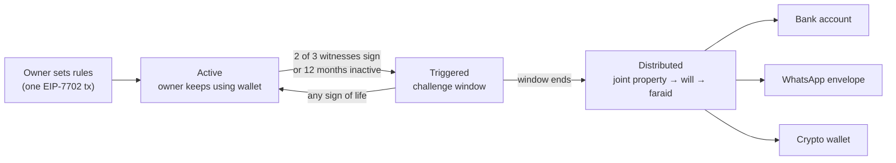

<div align="center">

<picture>
  <source media="(prefers-color-scheme: dark)" srcset="web/public/logo.svg" />
  
</picture>

# Pusaka

**Crypto inheritance, split by Islamic inheritance law (faraid), on Monad.**

Heirs don't need a wallet. The owner never has to press a button.

[**Live demo**](https://pusaka-faraid.vercel.app) ·
[Contracts](#deployed-contracts) ·
[Quick start](#quick-start) ·
[Docs](#documentation)

English · [Bahasa Indonesia](README.id.md)

-6E54FF)


</div>

---

## The problem

When someone dies, their crypto usually dies with them: nobody else has the seed phrase. And if the family does get
in, splitting it fairly is its own fight. In Indonesia, Muslim estates follow the Compilation of Islamic Law (KHI):
first take out the spouse's half of joint property, then the will (max 1/3), then split the rest among heirs by
fixed shares (faraid). Doing that by hand is slow, error-prone, and often ends up in court.

## What Pusaka does

The owner writes the inheritance rules **into their own wallet** once. Nothing has to be moved to a new contract.
When the owner dies, the wallet pays every heir their exact share, automatically.



| | How |
|---|---|
| **Rules live in the owner's wallet** | EIP-7702 turns the owner's normal address into a smart wallet. Funds stay where they are. |
| **Proof of life costs nothing** | Normal wallet activity counts. So does a signed "I'm still alive" message (sent by a relayer, Rp0 for the owner) or a **fingerprint / Face ID** check (passkey, verified on-chain by Monad's P-256 precompile). |
| **Death is confirmed by people, not one key** | 2 of 3 witnesses sign (gasless), or the wallet goes inactive for 12 months. A challenge window follows, and any sign of life cancels it. |
| **Exact faraid on-chain** | `FaraidLib` computes shares with exact fractions, including ‘awl, radd and ‘ashabah. Tested against 24 reference cases. |
| **Heirs don't need crypto** | Each heir picks how to receive: a **bank account** (virtual account at a payout partner → BI-FAST transfer, simulated on testnet), a **digital envelope** link sent over WhatsApp (cash out to a bank or e-wallet from a phone), or a crypto wallet. |

## Try it in 2 minutes

No wallet or install needed. Everything runs on Monad testnet with play-money rupiah (tIDR).

1. Open **[pusaka-faraid.vercel.app/pewaris](https://pusaka-faraid.vercel.app/pewaris)** (owner screen). Keep the
   sample family, choose how each heir receives, and sign. The demo wallet gets testnet gas automatically.
2. Open **[/saksi](https://pusaka-faraid.vercel.app/saksi)** (witnesses). Hold the button on two witness cards. The
   challenge window starts.
3. Back on the owner screen, wait for the challenge window to end (20 seconds in the demo; 12 months of inactivity
   in real use) and press **Bagikan warisan** (distribute).
4. Open **[/panggung](https://pusaka-faraid.vercel.app/panggung)** (stage view) or
   **[/hp](https://pusaka-faraid.vercel.app/hp)** (four phones side by side) to watch each heir's share arrive.
   Every step is a real transaction with a link to the block explorer.

Other screens: [`/kabar`](https://pusaka-faraid.vercel.app/kabar) (owner's phone: "I'm still alive", fingerprint),
[`/mitra`](https://pusaka-faraid.vercel.app/mitra) (payout partner, simulated bank),
[`/kalkulator`](https://pusaka-faraid.vercel.app/kalkulator) (faraid calculator).

## Deployed contracts

Monad testnet, chain id `10143`. Source verified on Sourcify (exact match).

| Contract | Address | Role |
|---|---|---|
| `PusakaWallet` | [`0xeea3b2c6040B0eACb3E451A6f13bA11db547e096`](https://testnet.monadvision.com/address/0xeea3b2c6040B0eACb3E451A6f13bA11db547e096) | Code the owner's wallet delegates to (EIP-7702): rules, witnesses, proof of life, distribution |
| `MitraCair` | [`0x04405E9Fd9ed041F81086259Bf200990B9EC315F`](https://testnet.monadvision.com/address/0x04405E9Fd9ed041F81086259Bf200990B9EC315F) | Payout partner: per-heir virtual bank accounts, envelope cash-out |
| `MockIDR` (tIDR) | [`0xbEe6644173F8eB599d83B9a6A92e7BE14b4242aB`](https://testnet.monadvision.com/address/0xbEe6644173F8eB599d83B9a6A92e7BE14b4242aB) | Play-money rupiah token (ERC-20 + permit) |

### Monad mainnet

The same contracts are also deployed on Monad mainnet, chain id `143`. Source verified on Sourcify (exact match). The live
demo runs on testnet so visitors can use it with play money.

| Contract | Address |
|---|---|
| `PusakaWallet` | [`0xf9749b6639a6C38f0904DE9Da7CF5AaE6d2e9286`](https://monadvision.com/address/0xf9749b6639a6C38f0904DE9Da7CF5AaE6d2e9286) |
| `MitraCair` | [`0x75ba83644f8d2AC4d547c39Fb19a7f95D326ED3E`](https://monadvision.com/address/0x75ba83644f8d2AC4d547c39Fb19a7f95D326ED3E) |
| `MockIDR` (tIDR) | [`0x824ce141538860ffc96bc5f244716AdA60B8843B`](https://monadvision.com/address/0x824ce141538860ffc96bc5f244716AdA60B8843B) |

| | |
|---|---|
| Live app | https://pusaka-faraid.vercel.app |
| Repository | https://github.com/astrorehan/pusaka |
| Deploy record | [testnet](contracts/broadcast/Deploy.s.sol/10143/run-latest.json) · [mainnet](contracts/broadcast/Deploy.s.sol/143/run-latest.json) |

## Quick start

**Requirements:** [Foundry](https://getfoundry.sh) and [Node.js](https://nodejs.org) 20+.

### 1. Clone and run the contract tests

```bash
git clone --recurse-submodules https://github.com/astrorehan/pusaka
cd pusaka/contracts
forge build
forge test
```

On Windows, run `git config --global core.longpaths true` before cloning (OpenZeppelin's nested submodules have
long paths).

### 2. Run the full app on a local chain

Terminal 1, start a local chain with Monad's rules:

```bash
anvil --network monad --block-time 1 --mixed-mining --code-size-limit 131072
```

Terminal 2, from the repo root:

```bash
npm install                       # relayer dependency (viem)
cd web && npm install
node scripts/deploy-lokal.mjs     # deploys all contracts, writes web/.env.local
npm run dev                       # http://localhost:5180
```

Anvil on another port? Prefix the scripts with `RPC=http://127.0.0.1:<port>`.

Open http://localhost:5180/pewaris and follow the same steps as the live demo. Restarted anvil? Run
`deploy-lokal.mjs` again and restart `npm run dev`.

### 3. End-to-end test without a browser

With anvil still running:

```bash
cd web && node scripts/e2e.mjs
```

It sets up an estate, confirms death with witnesses, distributes, pays out bank accounts and cashes an envelope,
all with real transactions.

### Running against Monad testnet

Deploy with `forge script` (see [`contracts/README.md`](contracts/README.md#deploy)), put the addresses and a
**testnet-only** key in `web/.env.monad.local` (template: [`web/.env.example`](web/.env.example)), check it with
`ENV_FILE=.env.monad.local node scripts/cek-siap.mjs`, then run `npm run dev -- --mode monad`. Monad-specific
behavior (reserve balance, gas billed on limit) is covered in [`web/README.md`](web/README.md#monad-testnet).

## How it works

```
Owner's wallet (EOA) ──EIP-7702──▶ PusakaWallet code
                                     ├─ FaraidLib   exact faraid shares
                                     ├─ EstateLib   KHI order: joint property → will → faraid
                                     ├─ WebAuthnLib passkey check via P-256 precompile
                                     └─ on distribute ──▶ MitraCair ──▶ virtual account per heir ──▶ bank (BI-FAST)
                                                                     └─▶ envelope (permit) ──▶ bank / e-wallet
Relayer (/api/induk, server only) sends signed check-ins and witness signatures, and sponsors gas.
```

**Why Monad:** `PusakaWallet` is ~28 KB, above Ethereum's 24 KB limit (Monad allows 128 KB). Passkeys are checked
on-chain with the P-256 precompile. Transactions confirm in 1–2 seconds, so the live demo feels instant.

Full design: [`docs/arsitektur.md`](docs/arsitektur.md).

## Project structure

```
contracts/   Solidity contracts and tests (Foundry)
web/         Vite + viem app: 9 screens wired to the contracts, scripts for deploy and e2e
web-next/    Next.js version of the same screens (this is what runs on Vercel)
relayer/     Server-side relayer: holds the gas wallet, never sent to the browser
api/         Vercel function wrapping the relayer
docs/        Product doc, architecture, faraid spec, judging criteria
```

## Tech stack

Solidity 0.8.30 · Foundry · OpenZeppelin · EIP-7702 · EIP-712 · EIP-2612 · EIP-1167 · WebAuthn (P-256) · viem ·
Vite · Next.js 15 · GSAP · Vercel

## Documentation

All docs are in Indonesian.

| Doc | What's inside |
|---|---|
| [`docs/PRD.md`](docs/PRD.md) | Product: problem, users, features, business model, demo script |
| [`docs/arsitektur.md`](docs/arsitektur.md) | Contracts: EIP-7702 wallet model, KHI order, proof of life, payout partner, functions, errors, gas |
| [`docs/faraid-spec.md`](docs/faraid-spec.md) | Faraid rules, algorithm, 24 test cases |
| [`docs/relayer-api.md`](docs/relayer-api.md) | Relayer API (`/api/induk`) |
| [`contracts/README.md`](contracts/README.md) | Contract list, tests, deploy, verification |
| [`web/README.md`](web/README.md) | Screens, local and testnet setup, hosting, Monad notes |
| [`web-next/README.md`](web-next/README.md) | Next.js version and Vercel setup |

## Disclaimer

Prototype on Monad testnet with play-money tokens. Bank transfers are simulated. Demo keys live in your browser:
never use a real wallet key. Not legal advice or a fatwa.

Built at **Monad Blitz Vol. 2** (24 October 2026).
